# Image Files

以下は、プロジェクト内の画像ファイルです。

## monochrome.svg
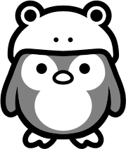

## monotone.svg

## standard.svg
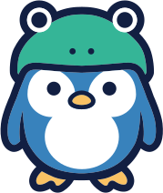

## pose-1.svg
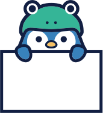

## pose-2.svg
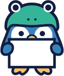

## pose-3.svg
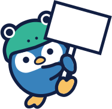

## pose-4.svg
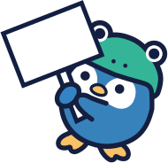

## pose-5.svg
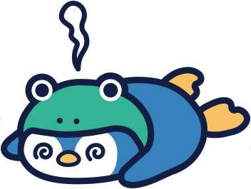

## pose-6.svg
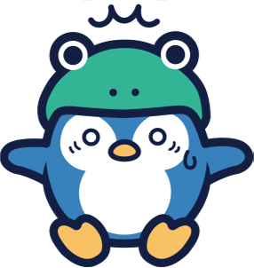

## pose-7.svg
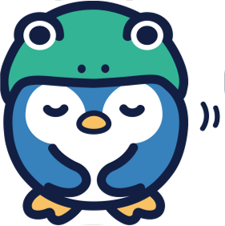

## pose-8.svg
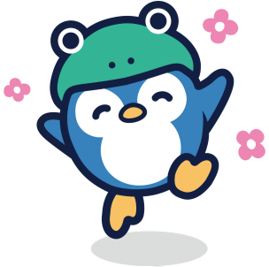

## pose-9.svg

## pose-10.svg
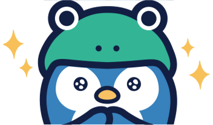

## pose-11.svg
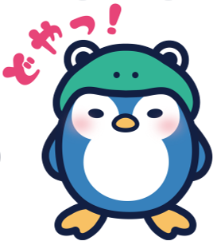

## pose-12.svg
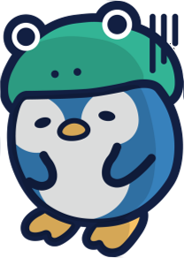

## book.svg

## book_notext.svg

## happy.svg

## ninomiya.svg

## rain.svg
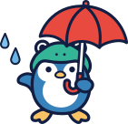

## rainbow_suberidai.svg
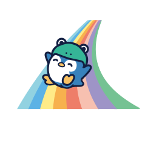

## reading.svg

## shabondama.svg
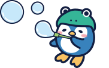

## umbrella.svg

## keropen_snaba.svg
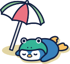

## keropen_surfin_1.svg

## keropen_surfine_2.svg
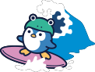

## keropen_ukiwa_1.svg

## keropen_ukiwa_2.svg

## keropen_ukiwa_3.svg

## keropen_watch.svg

## keropen_watermelon.svg
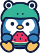

